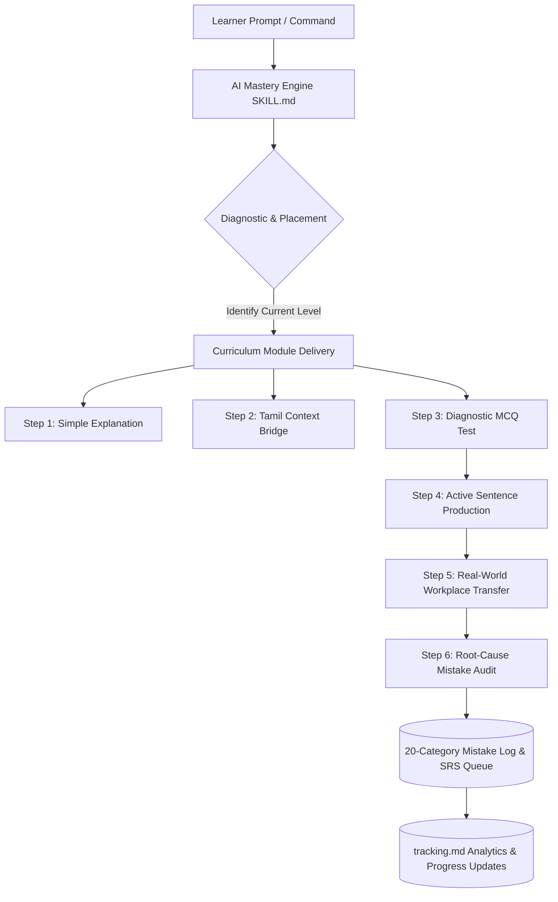

# 🎓 English Practice Mastery Engine — v4.0

> **A 400-Module Adaptive Learning System, Deliberate Practice Framework, and AI-Powered Workplace Communication Engine for Tech Professionals & ESL Learners.**

---

[](file:///.agents/skills/english-practice/SKILL.md)
[](file:///english-practice/curriculum/roadmap.md)
[-orange.svg?style=for-the-badge)](file:///english-practice/progress/tracking.md)
[](file:///.agents/skills/english-practice/SKILL.md)
[](file:///english-practice/progress/tracking.md)

---

## 📌 Executive Overview

The **English Practice Mastery Engine** is an enterprise-class, pedagogical agentic framework built to transform English language instruction from passive grammar rule memorization into **active output generation, deliberate sentence construction, root-cause error remediation, and natural workplace communication**.

Engineered specifically for ESL learners and software professionals (with a specialized cognitive bridge for **Tamil native speakers**), this system delivers structured, adaptive instruction through **400 granular modules** across 6 proficiency tiers—ranging from absolute sentence fundamentals to advanced tech interview defense, bug escalations, and executive email phrasing.

---

## 💡 Key Architectural Highlights



### 🧠 Core Features & Capabilities

1. **400-Module Masterclass Structure**: Progressive curriculum spanning Levels 0 through 5, enforcing strict prerequisite resolution (e.g., Subject-Verb-Object $\rightarrow$ Helping Verbs $\rightarrow$ Tense Consistency $\rightarrow$ Hedging & Workplace Disagreement).
2. **Bilingual Cognitive Bridging (Tamil $\leftrightarrow$ English)**: Leverages native grammar patterns (SOV structure vs SVO structure, tense equivalencies like *செய்வேன்* vs *I will do*) to eliminate systemic transfer errors.
3. **20-Category Mistake Taxonomy Matrix**: Tracks errors across 20 distinct linguistic dimensions (Subject-Verb Agreement, Article misuse, Preposition misplacement, Pluralization errors) with automated accuracy score tracking.
4. **Active Sentence Output Engine**: Mandates that the learner construct real, contextually relevant sentences for every concept learned.
5. **Workplace & Tech Communication Simulations**: Immersive scenarios covering Daily Stand-ups, Sprint Planning, Bug Escalations, Architecture Walkthroughs, and Technical Interview Prep.
6. **Spaced Repetition & Persistent Progress Tracking**: Real-time analytics tracking practice streaks, sentence volume, MCQ accuracy, topic mastery statuses, and mistake review queues in [tracking.md](file:///c:/Users/Mounika/Desktop/English/english-practice/progress/tracking.md).

---

## 🎯 The 15 Core Pedagogical Principles

The engine strictly operates under 15 non-negotiable principles:

| # | Principle | Description |
| :-: | :--- | :--- |
| **1** | **Simple-to-Complex Progression** | Never skip foundational prerequisites; build step-by-step. |
| **2** | **Strict Prerequisite Lock** | Never teach advanced structures (e.g., Conditionals) before core tenses are mastered. |
| **3** | **Plain-English Explanations** | Avoid jargon-heavy linguistic terminology; explain concepts naturally. |
| **4** | **Tamil Cognitive Bridging** | Use Tamil meaning and structure comparisons when helpful to clarify subtle differences. |
| **5** | **Practical Engineering Scenarios** | Use real tech/workplace contexts (APIs, UI bugs, databases, pull requests). |
| **6** | **Diagnostic MCQ Validation** | Verify conceptual understanding with targeted multiple-choice questions. |
| **7** | **Active Sentence Generation** | Mandate that the learner produce their own original sentences. |
| **8** | **Spaced Error Re-testing** | Re-introduce past mistakes in future sessions until full mastery is achieved. |
| **9** | **Focused Mistake Remediation** | Heavily drill repeated error patterns until accuracy exceeds 90%. |
| **10** | **Workplace Transfer Realism** | Move immediately from grammar rules to real-world emails, stand-ups, and discussions. |
| **11** | **Zero Grammar Overload** | Keep explanation snippets short, concise, and immediately actionable. |
| **12** | **Natural Over Textbook Phrasing** | Prefer contemporary professional English over outdated textbook expressions. |
| **13** | **Grammar before Style** | Fix structural correctness before refining elegance or vocabulary complexity. |
| **14** | **Preserve Learner Intent** | Retain the learner's original meaning when correcting phrasing. |
| **15** | **Persistent Progress Audit** | Log all statistics, accuracy rates, and error queues in [tracking.md](file:///c:/Users/Mounika/Desktop/English/english-practice/progress/tracking.md). |

---

## 🗺️ Curriculum Level Progression Roadmap

```
Level 0: Absolute Foundation  ──►  Level 1: Beginner Grammar  ──►  Level 2: Core Tenses
                                                                       │
Level 5: Workplace Mastery    ◄──  Level 4: Advanced Nuance  ◄──  Level 3: Intermediate
```

### Level Breakdown & Topic Matrix

| Level | Name | Modules | Target Competencies | Key Topics Covered | Sample Output |
| :-: | :--- | :-: | :--- | :--- | :--- |
| **0** | **Absolute Foundation** | 1–30 | Sentence structure baseline | Subject, Verb, Object, Nouns, Pronouns, Singular/Plural | *I test the code.* |
| **1** | **Beginner Grammar** | 31–80 | Core building blocks | Be Verbs (*am/is/are/was/were*), Articles (*a/an/the*), Prepositions (*in/on/at*) | *The server is in the cloud.* |
| **2** | **Core Tenses** | 81–160 | Temporal accuracy | 12 Tenses, Simple Present, Simple Past, Present Perfect, Future | *I have fixed the issue.* |
| **3** | **Intermediate** | 161–240 | Sentence complexity | Modals (*can/should/would*), Passive Voice, Conditionals, Conjunctions | *If the build fails, notify us.* |
| **4** | **Advanced Nuance** | 241–320 | Natural & professional phrasing | Hedging, Phrasal Verbs, Business Idioms, Tone Management | *It appears the latency increased.* |
| **5** | **Workplace Mastery** | 321–400 | Career & technical fluency | Stand-up updates, Bug escalations, Tech interviews, Salary negotiation | *I've resolved the blocker in API.* |

---

## 📊 20-Category Mistake Taxonomy Matrix

The system continuously audits learner output against a 20-category linguistic error matrix, maintaining real-time accuracy stats in [tracking.md](file:///c:/Users/Mounika/Desktop/English/english-practice/progress/tracking.md):

| Category ID | Error Classification | Typical Error Pattern | Root Cause / Tamil Context | Corrective Target |
| :-: | :--- | :--- | :--- | :--- |
| **01** | **Sentence Structure** | *Yesterday I API tested.* | Missing SVO order | *Yesterday I tested the API.* |
| **02** | **Subject-Verb Agreement** | *The API are returning 500.* | Confusion with singular subject | *The API is returning 500.* |
| **03** | **Be / Helping Verbs** | *I working on login.* | Dropping auxiliary verb | *I am working on login.* |
| **04** | **Verb Forms** | *I have complete the task.* | Past participle misuse | *I have completed the task.* |
| **05** | **Tense Selection** | *Yesterday I have met him.* | Present Perfect with past time | *Yesterday I met him.* |
| **06** | **Nouns (Count/Uncount)** | *We found many informations.* | Uncountable noun pluralization | *We found much information.* |
| **07** | **Pronouns** | *The team completed his task.* | Gender/Number mismatch | *The team completed its task.* |
| **08** | **Singular / Plural** | *15 test scenario passed.* | Missing plural `-s` modifier | *15 test scenarios passed.* |
| **09** | **Articles** | *I found bug in login.* | Missing indefinite article `a/an` | *I found a bug in the login module.* |
| **10** | **Prepositions** | *I will meet at Monday.* | `at` vs `on` day preposition | *I will meet on Monday.* |
| **11** | **Adjectives** | *This issue is more bad.* | Incorrect comparative form | *This issue is worse.* |
| **12** | **Adverbs** | *He explain quick.* | Adverb modifier suffix omission | *He explained quickly.* |
| **13** | **Conjunctions** | *Because it failed so I fixed.* | Double conjunction usage | *Because it failed, I fixed it.* |
| **14** | **Word Order** | *Always I check logs.* | Frequency adverb placement | *I always check logs.* |
| **15** | **Vocabulary Choice** | *I made a mistake in code.* | Weak verb-noun collocation | *I introduced a bug in code.* |
| **16** | **Collocations** | *Do a decision.* | Wrong verb pair | *Make a decision.* |
| **17** | **Phrasal Verbs** | *Call off the meeting.* | Misinterpretation of particle | *Cancel / Postpone the meeting.* |
| **18** | **Idioms** | *Touch base with team.* | Workplace phrase misuse | *Connect brief with team.* |
| **19** | **Natural Expression** | *I am knowing this code.* | Stative verb continuous misuse | *I know this codebase.* |
| **20** | **Workplace Tone** | *Fix this now.* | Overly direct command | *Could you please review this?* |

---

## 📁 Repository Directory Structure

```
.
├── .agents/
│   └── skills/
│       └── english-practice/
│           └── SKILL.md                 # 🤖 Main AI Agent Execution Skill Engine (v4.0)
├── ENGLISH_PRACTICE_SKILL.md            # 📜 Standalone Skill Definition Manifest
├── README.md                            # 📖 Enterprise Project Presentation & Documentation
└── english-practice/                    # 📂 Core Workspace & Practice Repositories
    ├── mistakes.md                      # 📝 Detailed Mistake Log & Root-Cause Remediation
    ├── benchmarks/                      # 📈 Diagnostic Placement Tests & Target Metrics
    ├── curriculum/                      # 🗺️ Module Specifications & Prerequisite Graphs
    │   ├── dependencies.md              # 🔗 Grammar Dependency Rules
    │   ├── personal-plan.md             # 👤 Personalized Learning Path
    │   └── roadmap.md                   # 📍 400-Module Master Roadmap
    ├── mistakes/                        # 🔍 Category-specific Error Tracking Files
    ├── practice/                        # 🏋️ Interactive Practice Drills & Simulations
    │   ├── daily/                       # 🗓️ Daily Mixed Micro-Drills
    │   ├── interview/                   # 💼 Technical & HR Interview Scenarios
    │   ├── listening/                   # 🎧 Audio & Comprehension Exercises
    │   ├── reading/                     # 📖 Technical Article & Spec Reading
    │   ├── speaking/                    # 🗣️ Voice-to-Text & Pronunciation Drills
    │   ├── workplace/                   # 🏢 Stand-up, Email, & Escalation Simulations
    │   └── writing/                     # ✍️ PR Description & Spec Writing
    ├── progress/                        # 📊 Persistent Progress & Analytics Database
    │   ├── benchmarks.md                # 🎯 Placement Diagnostic Results
    │   ├── monthly-reports.md           # 🗓️ Monthly Mastery Reports
    │   ├── tracking.md                  # ⚡ Real-Time Stats, Streaks, & Category Scores
    │   └── weekly-reports.md            # 📉 Weekly Accuracy Snapshots
    ├── pronunciation/                   # 🗣️ Phonetic Hotlists & Sound Queues
    │   ├── hotlist.md                   # 🔥 High-Frequency Pronunciation Challenges
    │   └── review-queue.md              # 🔄 Spaced Repetition Sound Drill Queue
    └── vocabulary/                      # 📚 Vocabulary Phrasebooks & Word Families
        ├── active.md                    # 🟢 Mastered Active Vocabulary
        ├── collocations.md              # 🔗 Tech & Business Collocations
        ├── phrasebook.md                # 📖 Workplace Phrasebook
        ├── review-queue.md              # ⏳ SRS Vocabulary Review Queue
        └── word-families.md             # 🌿 Noun/Verb/Adj Word Family Matrices
```

---

## 🚀 How to Execute with AI Agents

When loaded into an AI assistant (Antigravity, Claude, ChatGPT, Gemini, etc.), the system reads [.agents/skills/english-practice/SKILL.md](file:///.agents/skills/english-practice/SKILL.md) and automatically activates the mastery engine.

### Interactive Trigger Commands

You can initiate specific learning modes by sending any of the following slash-style triggers:

```bash
# 🎯 Start an adaptive diagnostic placement test
/placement-test

# 📚 Initiate the next sequential curriculum module
/next-lesson

# 🏋️ Run a 5-minute daily practice drill (Grammar + Vocabulary + Sentence)
/daily-drill

# 🏢 Simulate a Daily Agile Stand-up Update
/standup

# 🚨 Practice a Bug Escalation or Outage Communication
/bug-report

# 💼 Practice a Technical / System Architecture Interview Response
/interview-prep

# 🔄 Run a Spaced-Repetition Review of your recent mistakes
/mistake-review

# 📊 Check current streak, category accuracy, and level status
/progress
```

---

## 📈 Current Learner Dashboard Overview

As documented in [tracking.md](file:///c:/Users/Mounika/Desktop/English/english-practice/progress/tracking.md):

```
┌───────────────────────────────────────────────────────────┐
│ 🔥 Practice Streak    : 9 Days                            │
│ 📝 Sentences Written  : 72 Sentences                      │
│ 🎯 MCQ Accuracy       : 62.1% (41 / 66)                   │
│ 🟢 Grammar Accuracy   : 78.4% (48.6 / 62)                  │
│ 📚 Vocabulary Score   : 84.1% (18.5 / 22)                  │
│ 🔝 Current Level      : Level 2 (Core Tenses)             │
│ 💼 Workplace Fluency  : Level 5 (Stand-ups & Escalations) │
└───────────────────────────────────────────────────────────┘
```

---

## 🤝 Contributing & License

This repository is maintained for deliberate English mastery and technical communication excellence. Contributions to module lessons, phrasebooks, and Tamil conceptual bridges are welcome!

Distributed under the **MIT License**. Created by [Athavan Velmurugan](https://github.com/Athavanvelmurugan).